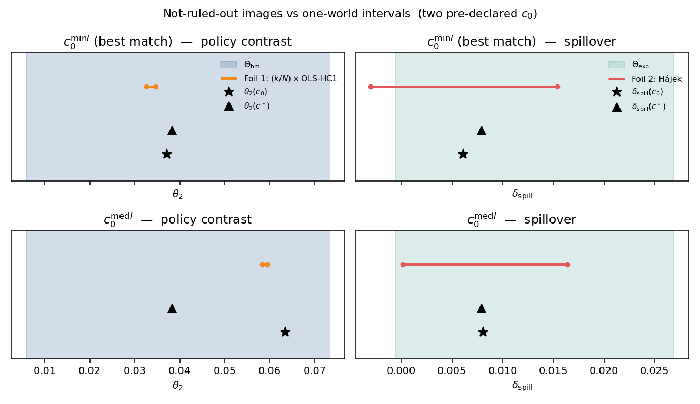

# ECN 593 applied project: honest images of a policy effect

A village agent-based model has five free parameters and four targets, so many parameter points fit the targets equally well. The project reports the image of a policy effect over the sampled parameter points that fit, and tests whether two one-world analysts give honest intervals.

## Why it matters

Calibrated simulators inform policy advice. Calibration usually ends in one "best" parameter point. If many points fit equally well, a one-world interval can look precise and still be wrong. The image is the honest report. It applies the partial-identification logic of Manski (2003) and Tamer (2010) to a calibrated simulator. The image is not an identified set in Tamer's sense (see "What the project does not claim").

## The design (pre-registration v2)

The design is frozen in `docs/preregistration-v2.md`. The code implements it. The earlier design is the git tag `v1-worldbank-moments`. Its targets contained the policy answer. It still replicates from that tag.

- **The model.** N = 800 people sit on a fixed random graph. Each person has a preventive-behavior level Y in (0, 1). A campaign seeds 10% of the people.
- **The targets.** Four targets z are planted: z = M(c*) at a known point c*, so the true effect is known. The targets are what a researcher could observe: the village in the status quo, plus one randomized pilot. The moments are `sq_level`, `sq_corr_x1`, `sq_peer_corr` and `pilot_level`. The policy to predict, seeding the highest-degree people, is never a target.
- **NROY and the image.** History matching evaluates three finite Latin-hypercube waves. NROY is the union of sampled points with I(c) at or below tau. Theta_hm is the range of theta2 over a declared uniform sample of 400 NROY points. Here theta2 is the effect of seeding the 80 highest-degree people, against no campaign.
- **Foil 1.** This analyst assumes no interference (SUTVA). The estimate is OLS on the degree arm, scaled by k/N = 0.1.
- **Foil 2.** This analyst models exposure to treated neighbors on a randomized arm. The target is the spillover delta_spill. The image of delta_spill is Theta_exp.
- **F-OVERCONF.** An interval is F-OVERCONF if it lies strictly inside its image. For Foil 1 this is a statement about interval geometry under the analyst's assumptions. It is not a coverage claim.
- **Three points, two analysts.** The calibrator fits the model and works at one best-fitting point. The code uses the min-I point and the median-I point of NROY. They are chosen by I only, never by the effect. The field experimenter has one panel from the real village, which is the planted point c*.
- **Two containment flags.** At every point, each foil gets `covers_truth` (the truth at that point) and `covers_planted_truth` (the truth at c*). At c* the two flags are equal. Both are descriptive indicators for one realized panel. They are not repeated-sampling coverage.

The v1 headline is retired. A v2 headline is not adopted yet: that decision is the project owner's. The paper (`thesis/main.pdf`) proposes one, marked as the owner's decision.

## Deliverables

- **The paper:** `thesis/` is a self-contained Overleaf project (pdfLaTeX + BibTeX, arXiv-ready). `thesis/main.pdf` is the built paper. It covers v2, amendment A1 (the delta menu), amendment A2 (three analysts for theta2) and addendum A2.1 (the variance split). Its class has two looks: `kaffeehaus` (default) and `mono`.
- **The v2 report:** `writeup/` is the earlier, verified v2 report. It is kept as the record of v2; the paper supersedes it.
- **The lecture video:** `video/` holds the sources of a 10-minute architecture walkthrough (Manim scenes, the script with a source for every claim, Phonon 31m narration). `video/README.md` says how to render it. The rendered mp4 is not in git.
- **Reviews:** every result and both papers were checked by a verifier from another model family. Verdicts are in `reviews/` (A2: `a2-code.md`; the paper: `thesis-paper.md`; the video script: `video-script.md`).



Rows are the min-I point, the median-I point and c*. The left column shows theta2 against Theta_hm, with the Foil 1 interval. The right column shows delta_spill against Theta_exp, with the Foil 2 interval. A star marks the truth at that point. A triangle marks the truth at c* (in the first two rows).

## The numbers

All numbers come from the JSON files in `results/`. The paper takes them from the generated `numbers.tex` file.

| Quantity | Value |
|---|---|
| Targets z (sq_level, sq_corr_x1, sq_peer_corr, pilot_level) | 0.2255, 0.0726, 0.0003, 0.2618 |
| Threshold tau (chi-square, 4 degrees of freedom) | 9.4877 |
| Points kept per wave (of 1000 each) | 181, 449, 408 |
| NROY size | 1,038 |
| Image Theta_hm (400 sampled NROY points) | [0.00577, 0.07369] |
| Image Theta_exp (400 sampled NROY points) | [−0.000578, 0.026525] |
| theta2 and delta_spill at the planted point c* | 0.03826 and 0.00792 |
| theta1 at c* (equal to pilot_level − sq_level, see below) | 0.03631 |

| | min-I point (I = 0.0141) | median-I point (I = 3.3437) | c* |
|---|---|---|---|
| Truth theta2 | 0.03933 | 0.05642 | 0.03826 |
| Foil 1 interval | [0.03057, 0.03285] | [0.04664, 0.04840] | [0.03267, 0.03479] |
| Foil 1 verdict | F-OVERCONF | F-OVERCONF | F-OVERCONF |
| Foil 1 contains the point truth, the planted truth | no, no | no, no | no, no |
| Truth delta_spill | 0.01271 | 0.01520 | 0.00792 |
| Foil 2 interval | [0.002988, 0.023619] | [0.005598, 0.026135] | [−0.001405, 0.017638] |
| Foil 2 verdict | F-OVERCONF | F-OVERCONF | no verdict |
| Foil 2 contains the point truth, the planted truth | yes, yes | yes, yes | yes, yes |

The pilot moment identifies theta1 by design. With paired reps, `pilot_level` − `sq_level` at c* equals theta1(c*) exactly. This is intended: a randomized pilot identifies theta1. The question is whether the model can extrapolate from it to theta2.

The endpoint recheck evaluates the points that set the Theta_exp endpoints again, with fresh reps. The lower candidate is +0.000200 (pilot: −0.000578). The upper candidate is +0.027542 (pilot: 0.026525). Both Foil 2 intervals at the min-I and median-I points stay strictly inside the range between these two fresh values. The recheck covers only the selected candidates. It does not bound the true extrema.

The readout `nroy_param_spread` shows which parameters the targets restrict. It is the standard deviation over the sampled NROY points, divided by the standard deviation of a uniform draw over C. A ratio near 1 means the targets do not restrict that parameter.

| Parameter | alpha | beta | gamma | kappa | sigma_eps |
|---|---|---|---|---|---|
| Ratio | 0.259 | 0.965 | 0.992 | 0.962 | 0.839 |

The pre-registration expected the peer-correlation moment to give a gamma ratio below 1. That expectation was not met: a ratio of 0.992 is no restriction.

Foil 2 calibration check: the nominal 95% interval covered 93.4% of assignments (exact 95% binomial interval 92.9%–93.9%). The average estimated variance was 1.034 times the empirical design variance.

Two facts about the graph: the global clustering coefficient is 0.0096 (3 × triangles / connected triples; the edge probability, which a random graph has in expectation, is 0.0100), and the mean degree is 8.085.

## Amendment A1: the delta menu

The main design takes a discrepancy delta of 0.02 for the two level moments. Amendment A1 of the pre-registration was written after the v2 results were known, and it says so. It does not test a hypothesis. It shows how the image depends on that one assumption. `scripts/delta_menu.py` reruns the waves, NROY, the 400-point image sample and `nroy_param_spread` with delta for `sq_level` and `pilot_level` set to 0.02, 0.01 and 0.005. The two correlation moments keep their delta. The main design does not change, and the menu is never used to pick a delta. The foils are not rerun: the intervals at c* do not depend on delta, so they are classified against each entry's images. The entry at 0.02 must equal the main run exactly. The script stops with an error if it does not. The output is `results/sensitivity/delta_menu.json`. The paper macros for it are `\MenuDelta<Entry><Item>` in `writeup/numbers.tex`.

## Amendment A2: three analysts for theta2

Amendment A2 asks what changes when an analyst allows interference. A0 is the existing SUTVA analyst. A1 transports exposure-stratum means from the random pilot. A2 also splits each stratum into fixed high-degree and low-degree bins. The target for all three analysts is theta2.

The script reads the three saved points and truths. It does not rerun the history-matching waves. It runs the declared fresh panel offsets and writes `results/interference/tradeoff.json`. An empty required A2 cell gives an undefined interval. The code never imputes that cell. The figure `figures/planted/tradeoff.png` shows absolute bias against mean interval width. The macro names use `\Tradeoff<Point><Analyst><Item>`.

## Addendum A2.1: descriptive variance split

Addendum A2.1 was written after the A2 results and review. It splits each reported variance into the positive-joint-probability term and Young-bound term. It also holds the noise fixed and redraws assignments. `scripts/a2_variance_split.py` writes the descriptive readout to `results/interference/variance_split.json`. It does not change an A2 estimate, interval, or verdict.

## How to replicate

One-time setup, then one command:

```bash
uv venv .venv --python 3.14
uv pip install --python .venv/bin/python -r requirements.txt -r requirements-dev.txt -c locks/freeze-planted.txt
.venv/bin/python scripts/replicate.py            # everything
.venv/bin/python scripts/replicate.py --quick    # skip the Foil 2 check and amendments A1/A2/A2.1
```

`replicate.py` has 12 steps. It runs the tests, the z check, the planted run, the Foil 2 check, and amendments A1, A2, and A2.1. Then it draws and copies the figures. It writes both `numbers.tex` files, builds the PDF, and compares each result with git HEAD. The PDF build needs TeX Live with `latexmk`. Without it, upload the project to Overleaf.

The steps, one at a time:

```bash
python scripts/plant_z.py                        # check: data/planted.json reproduces byte for byte
python scripts/run_poc.py planted                # the run -> results/planted/, figures/planted/
python scripts/check_foil2_coverage.py           # Foil 2 calibration check -> results/checks/foil2_coverage.json
python scripts/delta_menu.py                     # delta menu (amendment A1) -> results/sensitivity/delta_menu.json
python scripts/interference_tradeoff.py          # three analysts (amendment A2) -> results/interference/tradeoff.json
python scripts/a2_variance_split.py              # variance split (addendum A2.1) -> results/interference/variance_split.json
python scripts/draw_figures.py planted           # redraw figures from saved results (no simulation)
python scripts/sync_writeup_figures.py           # copy figures into writeup/ and thesis/
python scripts/write_numbers.py                  # write both numbers.tex files
```

Measured runtimes on an Apple-silicon laptop, in the repo at commit `cc01779`:

- The tests took 3 s (55 pass). The z check took under 1 s. The planted run took 243 s. The Foil 2 check took 233 s. The figure copy and the numbers took about 1 s each. These six steps take about 8 minutes.
- The paper (`writeup/main.tex`) is written for v2. A full `replicate.py` run on the final paper, with other jobs running on the same laptop, took 643 s: tests 4 s, planted run 325 s, Foil 2 check 310 s, PDF build 2 s. It printed REPLICATED, and the rebuilt PDF was byte-identical to the committed one.
- The delta menu (amendment A1) took 1,107 s: three entries of about 366 s each, with another job reading the repo on the same laptop. A full `replicate.py` run after the final paper edits (commit `442aa83`) took 1,793 s, about 30 minutes: tests 6 s, planted run 363 s, Foil 2 check 346 s, delta menu 1,075 s, PDF build 2 s. It printed REPLICATED, and the PDF was byte-identical to the committed one.
- The standalone interference tradeoff took 92 s. In the final full run, this step took 79 s.
- The final full A2 replication took 2,590 s. It ran 72 tests in 5 s and printed `REPLICATED: every result is identical to the committed one.`
- `replicate.py --quick` skips the Foil 2 check, the delta menu, the interference tradeoff, and the variance split.
- A second planted run after the commit changed only `ran_at` and `git_commit` in `results/planted/poc_results.json`. The files `image_points.json`, the figures and the lock file were byte-identical. The Foil 2 check file was also byte-identical after a second run. Every random stream is seeded, so a rerun reproduces every number.

Pins: Python 3.14, numpy 2.5.4, scipy 1.18.1, matplotlib 3.11.2, pytest 9.1.1. Reproducibility is part of the claim, so a rerun must match to the last digit. The file `locks/freeze-planted.txt` records the full environment of the run. It includes extra packages that the code does not import. The project does not use Mesa, pandas, or GPU libraries. The kernel is vectorized algebra.

Pin change on 2026-10-22. macOS 27.0.1 cannot load the compiled scipy 1.15.3 extension, so the pins moved from Python 3.11, numpy 2.4.6, scipy 1.15.3, matplotlib 3.10.3 and pytest 8.4.2. Every v2 result, figure and lock file was produced on the new pins. The v1 tag holds results from the older pins.

Two cautions. `run_poc.py` calls `uv` and overwrites the committed results, figures and lock file. `check_foil2_coverage.py` reads `results/planted/poc_results.json`, so run the planted run first. After a rerun, use `git diff results/` to compare your numbers with the committed ones.

## Repository layout

- `config/`: every exogenous parameter, chosen before any run. `world.toml` is the simulated village and the policy question. `design.toml` is the analyst's choices: the Monte Carlo reps, history matching (including `delta` for each moment name), the images, the foils and the Foil 2 check. Endogenous quantities are never in config: they live in `data/planted.json` and `results/`.
- `src/poc_abm/`: the code. The kernel, the moments, history matching, the estimands, the foils, the pipeline and the figures. `config.py` only loads the two TOML files.
- `scripts/`: `replicate.py` and the steps it runs, plus `draw_figures.py`.
- `tests/`: 72 tests. Most of them check hand-computed examples.
- `data/`: the targets z (`planted.json`).
- `results/`: the main run, the Foil 2 check, the delta menu, and the interference tradeoff.
- `figures/`: the figures of the run (`planted/`).
- `locks/`: the frozen package list of the run.
- `docs/`: the frozen pre-registration (`preregistration-v2.md`) and the sprint cards.
- `writeup/`: the paper as a self-contained Overleaf project: `main.tex`, `cover.tex`, `numbers.tex` (generated), `latexmkrc` (XeLaTeX, reproducible PDF), figure copies and the compiled `main.pdf`. Tests check that the figure copies and `numbers.tex` match the results.
- `thesis/`: the new Overleaf project. The replication scripts generate only `numbers.tex` and the files in `figures/`.

`SPECIFICATION.md` describes the code in detail. If the two disagree, the code is what ran.

## What the project does not claim

- Theta_hm is not a posterior. It is not a Manski/Tamer identified set. It comes from a thresholded discrepancy. Sampling noise is folded into the variance matrix V. The kernel is taken as true. The image shares the reporting logic of a set, so do not collapse it to a point.
- The closest NROY point (I = 0.0141) does not recover c*. Fit does not pick the truth.
- F-OVERCONF for Foil 1 is about interval geometry under the analyst's assumptions. It is not a coverage claim.
- The `covers_truth` and `covers_planted_truth` flags describe one realized panel. They are not repeated-sampling coverage.
- The sampled image can understate the true NROY image. The three waves are finite.
- The threshold tau is not a test level. V is diagonal, but the four moments are not independent: the control and random level moments share a state stream. And delta squared, not the sampling variance, fills V. So tau is a heuristic tolerance, not the critical value of a test.
- The foils' panel (rep 0) is also one of the 200 reps whose mean defines z. The foils see data that helped set the targets. The pipeline was not rerun without rep 0.
- Foil 2 and its truth are not the same estimand. The Hajek estimator targets the inverse-probability exposure contrast. The truth is the mean of the unweighted realized stratum contrasts. On this run no containment flag depends on the difference. This was not tested on another kernel.
- The width of Theta_hm is largely the assumption delta, not the count of moments. The level allowance (the square root of tau times delta squared) is larger than theta1(c*), so the pilot cannot pin kappa. The delta menu (amendment A1, written after the v2 results) shows how the image changes. It is a report, not a way to choose delta.
- The project has one planted world, one graph, and one set of targets. It claims no external validity.

## Planned extensions

1. A construct-validity layer. It scores Y through noisy or biased measures and screens the measures. It is parked until the core results are frozen. The code is at commit `ebed7ce`.
2. Image endpoints with a declared precision plan. Use more reps for every candidate before taking the extrema, or use a simultaneous procedure.
3. External targets with a stated target population and a transport model.
4. A design-based third foil. It needs randomization across villages.
5. A second kernel family. It shows how much of the image is due to the model choice.

## Status

Results freeze: 2026-11-20. Delivery: 2026-12-01.
